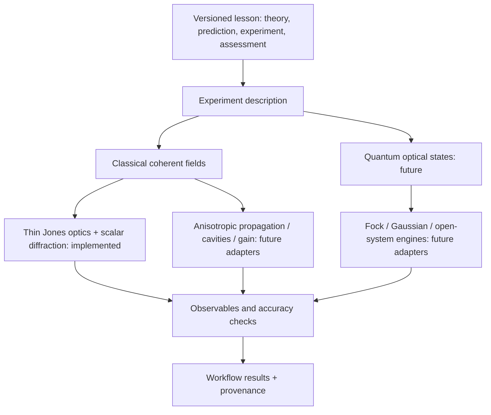
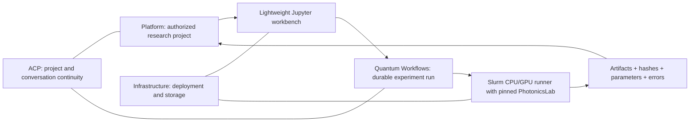

# A virtual photonics laboratory: architecture and delivery plan

Decision date: 1 November 2026. Implemented status is limited to the 0.6 alpha core,
one teaching notebook, a local lesson runner and an example workflow artifact adapter.
Everything explicitly marked future below is a plan, not an available solver.

## Language and scope

Use Python for the public experiment API, notebooks, analysis and orchestration.
NumPy provides a portable CPU reference. Reuse maintained specialist numerical
engines through optional adapters. Use C++/CUDA or compiled Python kernels only
after profiling identifies a numerical hotspot and an independent reference test
exists. A C++ rewrite of the teaching layer would add complexity without improving
the accuracy of the physical model.

A virtual table is a composition of physical components, sources and measurements;
the solver is chosen for the physical regime. An optical component should not
inherit from a heat solver simply to gain access to an HDF5 file. No object should
implicitly acquire an H200 or contact real hardware.



## Physical contracts

| Regime | State and equations | Required validity / verification |
| --- | --- | --- |
| Implemented thin polarization optics | Transverse coherent Jones envelope `(2, ny, nx)`; ideal projectors/retarders | Monochromatic, coherent, uniform ideal retarders; Malus, signed Stokes and unitary/loss checks. Not depolarizing or high-NA vector optics. |
| Implemented homogeneous diffraction | Fresnel paraxial transfer function, or scalar angular-spectrum Helmholtz dispersion independently for Ex/Ey | Periodic sampled window; resolve the field and phase masks; show grid/window convergence. Angular spectrum includes forward evanescent decay but these normalized Jones amplitudes do not supply an evanescent Maxwell Poynting-flux calculation. |
| Future partially coherent light | Coherency/Mueller or ensemble representation | Do not represent mixed polarization states with a single Jones vector. Validate ensemble convergence and Stokes positivity. |
| Future birefringent volume | Wavelength/temperature-dependent permittivity tensor, optic-axis orientation, coupled polarization propagation and walk-off | Thin-plate analytical limit, ordinary/extraordinary dispersion, rotations, power flux, mesh and longitudinal-step convergence; full-vector reference at interfaces/high angles. A fixed wave-plate retardance is not this model. |
| Future resonator / digital laser | Round-trip operator, boundaries, gain/loss and eigenmodes; Fox–Li / modal or specialist cavity engine | Gaussian ABCD stable-cavity limit, resonance frequencies, mode orthogonality/degeneracy, convergence, diffraction loss and mode competition. One pass through a lens is not a cavity simulation. |
| Future pumped laser / thermal effects | Population rate equations, pump absorption, saturated gain, heat diffusion, thermo-optic and stress coupling | Energy balance, threshold/slope limits, material parameter citations, time/mesh convergence, measured comparison where available. Avoid unvalidated dense volume matrices. |
| Future SPDC / nonlinear crystals | Phase matching and pump/signal/idler mode overlaps; quantum pair state / squeezing model in its valid regime | Crystal Sellmeier/temperature/axis conventions, energy/momentum matching, JSA normalization, Schmidt truncation, pair/coincidence statistics and independent literature/reference package. Classical intensity cannot stand in for pair probability. |
| Future DV/CV quantum optics | Explicit Fock, Gaussian-state or open-system representation | HOM visibility, distinguishability/loss, state trace/positivity, Fock cutoff convergence, vacuum noise and detector model. No hidden conversion from watts to a quantum state. |

The initial `Field` uses vacuum wavelength, an explicit uniform refractive index,
metres and radians. Its envelope has units `sqrt(W)/m`, with integrated squared
norm interpreted as optical power in the paraxial propagating regime. Its signed
convention is `Re[E exp(i*k*z - i*omega*t)]`, with the homogeneous carrier removed.
`S3 = 2 Im(integral conj(Ex)*Ey dA)` avoids ambiguous handedness labels.

`GaussianBeam.emit(grid)` creates a waist-plane source with discrete power
normalization. This can hide clipping, so users must inspect edge power and repeat
with a larger window. Field read-only arrays prevent accidental in-place changes
in built-in elements; this is an API convention, not a security boundary.
An empty or sequential `OpticalBench` stores final fields and scalar observations,
not every intermediate grid. Future branching interferometers need explicit ports,
path phase/delays and coherent recombination with a shared phase reference.

## Fit with the repositories being prepared for release

The following current source snapshots were inspected; other chat history was
not accessible in this task:

| Repository | Reviewed revision | Authority |
| --- | --- | --- |
| `quantum-platform` | `6b9c162d25d493590c876b0a86c1d0e6e3dc4fea` | Identity, programmes, entitlements, workbench / execution APIs, results UI |
| `quantum-workflows` | `741a54ee0d8fcb8eda6588b5ae69f01db06ef0df` | Scientific runners, lessons, Slurm entry points, canonical `RunArtifacts` and science provenance |
| `agent-control-plane` | `d978c48d7af282758097d69e4aaff28448244f98` | Persistent projects/conversations, agent tasks/skills, approvals and context |
| `infra-hpc-qc-k8s` | `f8ff7208c280297d7c575c3f5124408aa696a2a2` | Images/deployment, shared storage, Kubernetes workbenches, Slurm and resource placement |

PhotonicsLab is a versioned science dependency and validation library. It does not
duplicate any of those authorities. Finance, nuclear-physics, ion-trap and neutral-atom
laboratories can later share lesson metadata and workflow contracts while retaining
their native scientific states, solvers and independently validated assumptions.



The reviewed academy RFC proposes a 34-notebook photonics track; it does not contain
an approved published course. This first original lesson has a stable ID, declared
prerequisites/outcomes, numerical assessments and a locked environment. Review and
pin its source SHA, environment/image digest and assessment version before publication.
Do not silently import or relabel the proposed course notebooks as validated.

## Concrete integration available now

The local CLI produces its own clearly named lesson schema and unique run directory.
It records source/version/dirty state, parameters, NumPy/Python versions, input/output
powers, prediction error, field arrays and file checksums. It does not claim a clean
source SHA when the tree is dirty or invent one in an installed wheel without Git
metadata. The production runner must additionally pin the distributed image/wheel.

`examples/quantum_workflows_polarization.py` calls the existing public `RunArtifacts`
API, adds the PhotonicsLab science-source revision/version, and writes a screen,
observations and summary. Run it from the Quantum Workflows checkout so that the
current canonical artifact helper associates the runner SHA with the correct repository:

```bash
# In a runner environment containing both packages:
cd /path/to/quantum-workflows
python /path/to/photonicslab/examples/quantum_workflows_polarization.py --output results
# Optional regression checks against the installed canonical workflow package:
python -m pytest /path/to/photonicslab/integration_tests
```

This proves a local artifact boundary. It does not add a `qw photonics` command,
modify the platform execution allowlist, submit Slurm jobs or prove notebook-pod
restart persistence. Those changes belong in small, coordinated follow-up PRs.

## Delivery sequence and acceptance gates

1. **Foundation (this change).** Preserve historical work; unit-aware coherent fields,
   composed thin elements, homogeneous diffraction, prediction-based tests, one original
   notebook, local artifacts, locked environment and CI definition. Independent science /
   teaching review is still required for course publication.
2. **Release integration.** Add a version-pinned PhotonicsLab extra/runner and `qw`
   entry point in Quantum Workflows; register a credential-free CPU offering through
   the existing platform policy. Verify project-scoped artifacts, canonical provenance,
   cancellation/retry semantics and durable execution after a workbench restart. First
   numerical cross-check against HCIPy/LightPipes; no API integration by guesswork.
3. **Tabletop breadth.** Explicit splitters/ports, coherent path recombination, mirrors,
   Mach–Zehnder/Michelson, diffraction and beam shaping; finite extinction/retardance,
   apertures/detectors and calibrated noise. Require phase-sensitive interferometer tests
   and lens/mask sampling diagnostics, not only total power.
4. **Resonators, media and pumping.** Add each regime in the table separately, starting
   with stable empty cavities and uniform birefringent slabs. Move historical ideas only
   after analytical, convergence and experimental/reference checks. Then rate equations,
   thermal feedback and SLM-selected digital laser modes.
5. **Quantum photonics.** Start with small DV linear-optical circuits / HOM using a
   maintained engine; then SPDC spectra and pair states, loss/detection, entanglement
   and CV models. Teach what each representation can and cannot predict.
6. **Accelerated research.** Profile a genuinely large validated calculation. Offer
   dedicated A100/H200 runner images, chunked storage and optional batched/differentiable
   engines; add distributed execution only where measured benefit justifies it.

## GPU performance without changing the lesson

Current code is **CPU-only**. There is no GPU flag that silently falls back to CPU.
Future backends must explicitly check allocation, device visibility, precision,
supported physics, CUDA libraries and memory. Test phase/intensity/error equivalence
against the CPU reference before performance claims.

A 4096² two-polarization complex128 field alone occupies 512 MiB. FFT work buffers,
input/output copies, transfer functions and stored snapshots multiply that footprint.
Stream propagation planes, avoid accidental host/device transfers and budget memory
before choosing grids. Record wall time, synchronization, transfer/setup overhead,
peak memory, precision and accuracy. A small polarization lesson demonstrates
correctness and portability, not GPU speedup.

The same notebook should request a logical validated execution capability; the
platform resolves placement and releases scarce resources after each stage. Public
lessons should not hardcode cluster partitions, node addresses or credentials.
Hardware-control drivers use a separate explicit capability and calibration record.

## Notebook-first teaching and independently scheduled acceleration (M5)

> **Scientific preparation is cheap; expensive execution is scheduled.**

PhotonicsLab stays the **authoritative source of validated optics and photonics numerical models**. Quantum Workflows owns notebook lessons, reviewed experiment runners and result contracts, while Quantum Platform retains the existing authenticated JupyterHub/KubeSpawner portal. A notebook workbench uses small CPU resources to build optical benches, tune components, visualise interferometers or demonstrate idealised QKD. Large wave-optics grids, beam propagation, GPU arrays or parameter sweeps, **if scientifically justified and implemented**, become independent Slurm CPU/GPU batch jobs with explicit user allocations rather than long-lived interactive GPU notebooks.

Do not equate coherent Jones-field simulation, classical photonics GPU compute, a quantum photonic source/measurement model and a physical quantum processor. The tutorial/runner must specify the physical approximation, boundary conditions, measurement model, independent numerical reference, error tolerance and provenance. H200 is a **remote site**: stage inputs and reduced results through an approved transfer path, never rely on an SSHFS symlink or remote NFS mount for large compute I/O. Use small immutable purpose-built images derived from the validated model's dependencies, not a universal CUDA/PennyLane/Qiskit/Pulser environment.

The exact initial quantum-computing notebook sequence 00–07 is maintained by [Quantum Workflows](https://github.com/nyameko/quantum-workflows/tree/dev/labs/01-intro-quantum-computing/batch-first); PhotonicsLab-specific waveplates, detectors, coincidences, interferometry, tabletop optical components and pedagogical QKD become a *subsequent* focused track, without claiming unimplemented high-fidelity SPDC/Fock/Gaussian models or H200 GPU acceleration.

Cross-project gate: P0 native authenticated per-user Slurm; P1 verified science GPU isolation; P2 real A100 batch; P3 remote H200 staged results; P4 unchanged Quantum Platform Runs; P5 dedicated backend/correctness test suite (including validated photonics when ready); P6 optional ACP Guide assistance. Documentation is a plan, not evidence of deployed photonics GPU kernels or live facility acceptance.
