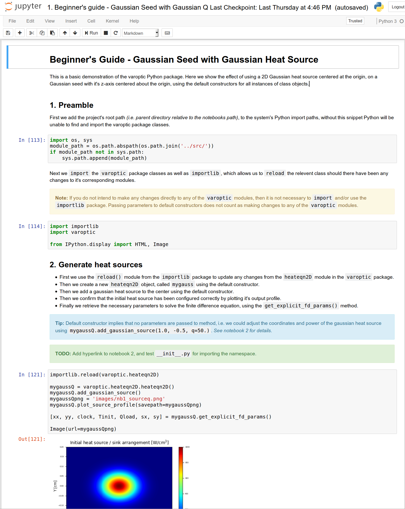

About
=====

Photonics LABoratory: Software for the simulation, analysis, design,
interface and control of optical hardware and photonics components.

Installation
============

Where possible to development and simulation ecosystem will strive to be
as `Pythonic <https://www.python.org/dev/peps/pep-0008/>`__ as possible.
However, we do accommodate MatLab appliances and interfaces in many
instances.

Dependencies
------------

This package was built using and tested against these versions of

-  Python: `3.6.3 <https://www.python.org/>`__,
-  Numerical Python: `NumPy 1.13.3dev1 <http://www.numpy.org/>`__,
-  Scientific Python: `SciPy 1.0.0-1 <https://www.scipy.org/>`__,
-  Hierarchical Binary Data Format: `HDF5
   1.10.1-1 <https://support.hdfgroup.org/HDF5/>`__,
-  Python Bindings for HDF5: `H5Py 2.7.1-1 <http://www.h5py.org/>`__,
-  Matplotlib: `2.1.0-1 <https://matplotlib.org/>`__,
-  Specialised image processing routines for SciPy: `Scikit-Image
   0.13.1-1 <http://scikit-image.org/>`__,
-  Python Testing Framework: `PyTest
   3.4.0-1 <https://docs.pytest.org/en/latest/>`__,
-  PyTest Distributed Testing Plugin: `PyTest-XDist
   1.22.0-1 <https://docs.pytest.org/en/3.0.0/xdist.html>`__,
-  PyTest fixture for benchmarking code: `PyTest-Benchmark
   3.1.1-1 <https://pypi.python.org/pypi/pytest-benchmark>`__,
-  Python Code Coverage Measurement: `PyTest-Cov
   2.5.1-1 <http://pytest-cov.readthedocs.io/en/latest/>`__, and
-  Universal document converter: `Pandoc 2.0.6 <https://pandoc.org>`__,
-  Open-source, production-grade container orchestration system for
   automating application deployment, scaling, and management:
   `Kubernetes <https://kubernetes.io/>`__,
-  Local Kubernetes cluster implementation:
   `minikube <https://github.com/kubernetes/minikube>`__,
-  Open-source monitoring system with a dimensional data model, flexible
   query language, efficient time series database and modern alerting
   approach: `Prometheus <https://prometheus.io/>`__,
-  Open platform for analytics and monitoring:
   `Grafana <https://grafana.com/>`__,
-  NVIDIA parallel computing platform and API: `CUDA
   9.1.85.3-5 <http://docs.nvidia.com/cuda/>`__,
-  NumPy aware dynamic Python compiler: `Numba
   0.38.0-1 <https://numba.pydata.org/>`__,
-  NVIDIA CUDA Toolkit provides a development environment for creating
   high performance GPU-accelerated applications:
   `CUDAToolkit <https://developer.nvidia.com/cuda-toolkit>`__,
-  Python wrapper for Nvidia CUDA: `PyCUDA
   2017.1.1-5 <https://wiki.tiker.net/PyCuda>`__,
-  Python interface to many of the functions in the CUDA device/runtime
   (e.g. CUBLAS, CUFFT and CUSOLVER) `Scikit-CUDA
   0.5.2 <http://scikit-cuda.readthedocs.io/en/latest/index.html>`__,
-  NVIDIA Collective Communications Library to perform collective
   multi-GPU / multi-node computations `NCCL
   2.1.15 <https://developer.nvidia.com/nccl>`__ (NVIDIA Developer
   Programme Registration Required),
-  NumPy-like API accelerated with CUDA
   `CUPY <https://github.com/cupy/cupy>`__.

Add ``/opt/cuda/bin`` to ``/etc/profile`` for access to the NVIDIA
compiler and bindings.

Anaconda
~~~~~~~~

Most of the above dependencies can be satisfied by installing the Python
3.6. version of `Anaconda
5.0.1 <https://conda.io/docs/user-guide/install/download.html>`__.
However with regards to the Python Bindings for HDF5, imaging routines
from scikit, the testing framework and Pandoc, you’ll need to run the
following within your Anaconda environment.

::

   $ conda install h5py
   $ conda install scikit-image
   $ conda install pytest
   $ conda install pytest-cov
   $ conda install pytest-xdist
   $ conda install pytest-benchmark
   $ conda install pandoc
   $ conda install cupy-cuda91
   # $ conda install cudatoolkit
   # $ conda install numba
   $ conda install scikit-cuda

Future dependencies
~~~~~~~~~~~~~~~~~~~

-  `Pandas <http://pandas.pydata.org/>`__: High performance data
   analysis,
-  `Scikit-Learn <http://scikit-learn.org/stable/>`__ and
   `TensorFlow <https://www.tensorflow.org/>`__: Specialised tools for
   machine learning, data mining and data analysis,

   -  `Tensorflow-CUDA <https://www.nvidia.com/en-us/data-center/gpu-accelerated-applications/tensorflow/>`__:
      GPU-Accelerated TensorFlow, *(see python-tensorflow-opt-cuda)*,

-  `CUDNN <https://developer.nvidia.com/cudnn>`__: Nvidia CUDA Deep
   Neural Network Library,

   -  `PyTorch <http://pytorch.org/>`__: Tensors and Dynamic neural
      networks in python with strong GPU acceleration,
   -  `PyTorch-CUDA <http://pytorch.org/docs/master/cuda.html>`__:
      Support for CUDA tensor types, *(see python-pytorch-cuda)*,

-  `OpenCV <https://opencv.org/>`__: Open Source Computer Vision
   Library,
-  `OpenCL <https://www.khronos.org/opencl/>`__: (Open Computing
   Language) is the open, royalty-free standard for cross-platform,
   parallel programming of diverse processors found in personal
   computers, servers, mobile devices and embedded platforms,

   -  `PyOpenCL <https://mathema.tician.de/software/pyopencl/>`__:
      Python wrapper for OpenCL,

-  `Keras Multi GPU
   Blog <https://github.com/rossumai/keras-multi-gpu/blob/master/blog/docs/algorithms-and-techniques.md>`__,
-  `ReScale
   TensorFlow <https://blog.rescale.com/deep-learning-with-multiple-gpus-on-rescale-tensorflow/>`__:
   Deep learning with multiple, distributed GPUs,
-  `MapR and Kuberbetes <https://mapr.com/blog/deep-learning-qss-1/>`__:
   Deploy distributed Deep Learning QSS on GPU Cluster.

Usage
=====

A good resource and basic introduction to the scientific Python stack
and it’s uses is `Tim Fuller’s FEM with
Python <https://github.com/tjfulle/fem-with-python>`__.

Use Git to get source-code
--------------------------

Once you’ve `Created your Bitbucket
Account <https://bitbucket.org/account/signup/>`__ and added your
`public
ssh-key <https://confluence.atlassian.com/bitbucketserver/creating-ssh-keys-776639788.html>`__
to the private `Bitbucket NLC Novel
Lasers <https://bitbucket.org/account/user/nlcnl/ssh-keys/>`__
repository by emailing it to the `admin <mailto:Nlisa@csir.co.za>`__,
you can get access to the source by:

::

   $ cd your_desired_working_folder
   $ git clone git@bitbucket.org:NLisa/photonicslab.git your_desired_checkout_name

   # Or without ssh-keys
   $ git clone https://bitbucket.org/NLisa/photonicslab.git your_desired_checkout_name

To actively contribute to development of the project, `Create a
Fork <https://confluence.atlassian.com/bitbucket/forking-a-repository-221449527.html>`__
on your Bitbucket account and use it `Locally
Edit <https://git-scm.com/book/en/v2/Git-Basics-Working-with-Remotes>`__
your local checkout of the source code, then `Pull
Changes <https://git-scm.com/docs/git-pull>`__ from the original
Photonicslab repository, and `Push Your
Changes <https://help.github.com/articles/pushing-to-a-remote/>`__ back
to your remote Bitbucket account:

::

   $ cd your_desired_working_folder
   $ git remote add <your_desired_fork_name> <url_to_your_bitbucket_fork>
   $ git pull origin
   $ git push <your_desired_fork_name>

Finally from your Bitbucket account web page, you can then `Submit Pull
Requests <https://confluence.atlassian.com/bitbucket/create-a-pull-request-774243413.html>`__,
see the `Bitbucket
Tutorial <https://confluence.atlassian.com/bitbucket/tutorial-learn-about-pull-requests-in-bitbucket-cloud-774243385.html>`__
or `Atlassian Git Syncing
Tutorial <https://www.atlassian.com/git/tutorials/syncing>`__ should you
have any difficulties.

Jupyter Notebooks
-----------------

The developer or end-user can learn to use the software through a series
of `Jupyter Notebooks <http://ipython.org/notebook.html>`__, which are
included with the `src <https://bitbucket.org/nlcnl/varoptic/src>`__.
These lessons provide a set of interactive literate programming tools
that are `very
effective <https://drivendata.github.io/cookiecutter-data-science/>`__
for exploratory data analysis. The sub-folder ``notebooks/reports``
contains more polished work that is *\`near-publication-ready’*.
Generally speaking these serve as high level functional, systems or
acceptance tests.

   img

First change directory into the notebooks folder and then start the
notebook server:

::

   $ cd notebooks
   $ jupyter notebook

This will start the interactive Python session in your browser and from
there you can start the Lessons.

Project Layout and Documentation
--------------------------------

::

   ├── docs
   │   ├── conf.py
   │   ├── html
   │   │   ├── index.html
   │   ├── index.rst
   │   ├── methods.rst
   │   └── README.rst
   ├── index.html
   ├── LICENSE
   ├── Makefile
   ├── Manifest.in
   ├── notebooks
   │   ├── Lesson 00. Introduction to Git, Anaconda (Python), Kubenetes (Docker), Prometheus, Grafana and CUDA.ipynb
   │   ├── Lesson 01. Introduction to PhotonicsLAB (2D Gaussian heat source pair).ipynb
   │   ├── Lesson 02. Demonstration of 2D phase modulated (VarOptic) Gaussian beam generation and propagation.ipynb
   │   ├── Lesson 03. Demonstration of 2D phase modulated (VarOptic) LG-mode generation and propagation.ipynb
   │   ├── Lesson 04. Demonstration of 2D source addition from an image file.ipynb
   │   ├── Lesson 05. Demonstration of 2D dynamic and temporal heat source.ipynb
   │   ├── Lesson 06. Demonstration of 2D sequential thermal lensing of a beam through consecutive elements.ipynb
   │   ├── Lesson 07. Demonstration of 2D thermal lensing based shaping using pixelated (addressable) VarOptic.ipynb
   │   ├── Lesson 08. Demonstration of 3D LG-Mode collamation, imaging and M-Squared measurements.ipynb
   │   ├── Lesson 09. Demonstration of 3D transient heat eqn and phase modulated (VarOptic) Gaussian beam generation and propagation.ipynb
   │   ├── Lesson 10. Demonstration of 3D (VarOptic) quad-source phase modulated LG mode.ipynb
   │   ├── Lesson 11a. Demonstration of 3D (VarOptic) 4mm flat-top pump, focusing thermal lens.ipynb
   │   ├── Lesson 11b. Demonstration of 3D (VarOptic) 2mm flat-top pump, focusing thermal lens.ipynb
   │   ├── Lesson 12. Demonstration of 3D (VarOptic) Gaussian to Bessel Beam to Doughnut Transformation.ipynb
   │   ├── Lesson 13. Demonstration of 3D (VarOptic) Gaussian to Flat-top Transformation.ipynb
   │   ├── Lesson 14. Demonstration of 3D fully vectorial single pass focusing of TEM00 Gaussian mode by GRIN Lens-like medium.ipynb
   │   ├── Lesson 15. Demonstration of 3D fully vectorial single pass through two laser rods with Faraday rotator in-between.ipynb
   │   ├── Lesson 16. Demonstration of 3D fully vectorial stress induced (pinched optics) birefringent distortions.ipynb
   │   ├── Lesson 17. Demonstration of 3D fully vectorial single pass addressable gain amplifier.ipynb
   │   ├── Lesson 18. Demonstration of 3D fully vectorial single pass amplification with thermal lensing and birefringence.ipynb
   │   ├── Lesson 19. Demonstration of 3D fully vectorial single transeverse mode Yb-YAG disk statble resonator with thermal lensing and birefringence.ipynb
   │   ├── Lesson 20. Demonstration of 3D fully vectorial pixelated gain (addressable) diode laser.ipynb
   │   ├── Lesson 21. Report - Demonstration of 3D thermal lensing effects of different coatings on glass and saffire.ipynb
   │   ├── Lesson 22. Report - Benchmarking various GPU-accelerated frameworks.ipynb
   │   ├── Lesson 23. Report - Convolutional neural network for fully vectorial output beam prediction from arbitrary pump - seed configuration.ipynb
   │   ├── Lesson 24. Acceptance Tests for Supervised Machine Learning of Conjugate Phase and Polarization Profiles.ipynb
   │   ├── Lesson 24. Acceptance Tests for Wavefront Reconstruction using SLM CGHs.ipynb
   │   ├── hdf5db
   │   │   └── storage.hdf5
   │   ├── images
   │   ├── reports
   │   │   ├── Experimental validation of 3D Flat-Top Thermal Lensing Simulation.ipynb
   │   │   └── Comparrison of Thermal Lensing Abberrations Between Fused Silica and Saphire.ipynb
   │   ├── storage.hdf5
   │   └── videos
   ├── README.md
   ├── README.org
   ├── requirements.py
   ├── setup.py
   ├── tests
   │   ├── conftest.py
   │   ├── beamprop
   │   │   ├── conftest.py
   │   │   └── test_beamprop.py
   │   ├── fdsolver
   │   │   ├── conftest.py
   │   │   └── test_fdsolver.py
   │   ├── gaussian_heat_source
   │   │   ├── conftest.py
   │   │   └── test_gaussian_heat_source.py
   │   ├── heateqn
   │   │   ├── conftest.py
   │   │   └── test_heateqn.py
   │   ├── phasemod
   │   │   ├── conftest.py
   │   │   └── test_phasemod.py
   │   ├── visualize
   │   │   ├── conftest.py
   │   │   └── test_visualize.py
   ├── pytest.ini
   ├── usage.png
   └── photonicslab
       ├── __init__.py
       ├── amplifier.py
       ├── beamprop.py
       ├── beamqual.py
       ├── config.py
       ├── fdsolver.py
       ├── gaineqn.py
       ├── heateqn.py
       ├── maxwelleqn.py
       ├── phasemod.py
       ├── resonator.py
       ├── anisotropy.py
       └── visualize.py

Application Programming Interface
---------------------------------

The `API <https://docs.python.org/3/c-api/intro.html>`__ and developer
documentation was built using `Sphinx
1.6.5-2 <http://www.sphinx-doc.org/en/stable/>`__, and generated
automatically and directly from the source-code and is available to be
viewed in a browser as follows:

::

   $ firefox docs/html/index.html

Configuring Sphinx
~~~~~~~~~~~~~~~~~~

::

   $ sphinx-quickstart

After `configuring
Sphinx <http://www.sphinx-doc.org/en/stable/tutorial.html>`__ to build
the documentation, enable
`Napoleon <http://www.sphinx-doc.org/en/stable/ext/napoleon.html>`__
which is a `Sphinx
Extension <http://www.sphinx-doc.org/en/stable/extensions.html>`__
allowing one to use either
`Google <https://google.github.io/styleguide/pyguide.html>`__ or
`NumPy <https://github.com/numpy/numpy/blob/master/doc/HOWTO_DOCUMENT.rst.txt>`__
style `docstrings <https://www.python.org/dev/peps/pep-0287/>`__, and
change the theme. Note that this project subscribes to the `Google
docstring
convention <http://www.sphinx-doc.org/en/stable/ext/example_google.html>`__.
Also, ensure that the
`MathJax <http://www.sphinx-doc.org/en/stable/ext/math.html#module-sphinx.ext.mathjax>`__
extension is also enabled as this JavaScript package is used to
transform the as-is LaTeX markup to readable math live in the HTML
browser. Make sure to also enable the
`AutoDoc <http://www.sphinx-doc.org/en/stable/ext/autodoc.html#module-sphinx.ext.autodoc>`__
and
`AutoSummary <http://www.sphinx-doc.org/en/stable/ext/autosummary.html>`__
extensions to enable automatic documentation generation directly from
the source code’s doctstrings. Configure support for `todo
items <http://www.sphinx-doc.org/en/stable/ext/todo.html>`__. Configure
support for `inheritance
diagrams <http://www.sphinx-doc.org/en/stable/ext/inheritance.html>`__.
In addition, the ``html_sidebars`` directive add documentation traversal
links to all the source pages, *see* <./docs/methods.rst> for automatic
generation of single page function definitions. Finally configure
`Intersphinx <http://www.sphinx-doc.org/en/stable/ext/intersphinx.html>`__
to link to other project’s documentation.

::

   # ./docs/conf.py
   #---------------

   # Add napoleon to the extensions list
   extensions = [..., 'sphinx.ext.napoleon', 'sphinx.ext.mathjax', 'sphinx.ext.autodoc',
                 'sphinx.ext.autosummary', 'sphinx.ext.intersphinx', 'sphinx.etx.todo',
                 'sphinx.ext.inheritance_diagram'...]
   # ...
   autosummary_generate = True # Make _autosummary files and include them
   napoleon_numpy_docstring = False
   napolean_use_rtype = False
   todo_include_todos = True
   inheritance_graph_attrs = dict(rankdir='TB', size='""')
   # ...
   html_theme = 'classic'
   # ...
   html_sidebars = {
       '**': [
           'localtoc.html',
           'relations.html',  # needs 'show_related': True theme option to display
           'searchbox.html',
       ]
   # ...
   intersphinx_mapping = {'python': ('https://docs.python.org/3/', None),
                          'numpy': ('http://docs.scipy.org/doc/numpy/', None),
                          'scipy': ('http://docs.scipy.org/doc/scipy/reference', None),
                          'matplotlib': ('http://matplotlib.sourceforge.net', None),
                          'h5py' : ('http://docs.h5py.org/en/latest/', None),
                          'sklearn': ('http://scikit-learn.org/stable/', None)}

To render mathematics in web pages using LaTeX, ensure that you have
MathJax installed on your system, see `Getting Started with
MathJax <http://docs.mathjax.org/en/latest/start.html>`__.

To render the inheritance diagrams for the application programming
interface, ensure that you have `Graphviz <https://www.graphviz.org>`__
installed on your system.

One is encouraged to refer to the following resources with regards to
the docstring conventions and constructs:

-  `reStructuredText
   Primer <http://www.sphinx-doc.org/en/stable/rest.html>`__: Brief
   introduction to reStructuredText(reST) concepts and syntax.
-  `Math support in
   Sphinx <http://www.sphinx-doc.org/en/stable/ext/math.html>`__: Keep
   in mind that when you put math markup in **Python doc-strings** read
   by
   `autodoc <http://www.sphinx-doc.org/en/stable/ext/autodoc.html#module-sphinx.ext.autodoc>`__,
   you either have to double all backslashes, or use Python raw strings
   (r“raw”). The convention in this project is to double all
   backslashes.
-  `Inline
   markup <http://www.sphinx-doc.org/en/stable/markup/inline.html>`__:
   Sphinx uses interpreted text roles to insert semantic markup into
   documents.
-  `Documenting Your Project Using
   Sphinx <https://pythonhosted.org/an_example_pypi_project/sphinx.html>`__:
   This covers a few of the many, many commands available via sphinx.

Configuring API landing page
~~~~~~~~~~~~~~~~~~~~~~~~~~~~

::

   #./docs/index.rst
   #-------------------------
   .. photonicslab documentation master file, created by
      sphinx-quickstart on Thu Dec  7 15:55:26 2017.
      You can adapt this file completely to your liking, but it should at least
      contain the root `toctree` directive. Check indentation of indices and tables.

   Quick Start
   ===========

   .. toctree::
      :maxdepth: 3
      :caption: Getting Started Guide

      quickstart

   Documentation
   =============

   .. toctree::
      :maxdepth: 3
      :caption: Photonicslab's Documentation:

      README

   API
   ===

   .. inheritance-diagram::
      photonicslab.isotropy
      photonicslab.heateqn
      photonicslab.fdsolver
      photonicslab.phasemod
      photonicslab.beamprop
      photonicslab.anisotropy
      photonicslab.gaineqn
      photonicslab.optomech
      photonicslab.amplifier
      photonicslab.resonator
      photonicslab.beamqual
      photonicslab.geometry
      photonicslab.adaptopt
      photonicslab.demultiplex
      photonicslab.aberration
      photonicslab.visualize
      :parts: 2

   .. toctree::
      :maxdepth: 2

      methods

   Indices and tables
   ==================

   * :ref:`genindex`
   * :ref:`search`

   TODO List
   =========

   .. todolist::

Configure API Function Definitions
~~~~~~~~~~~~~~~~~~~~~~~~~~~~~~~~~~

::

   #./docs/methods.rst
   #---------------------------
   Application Programming Interface
   =================================

   .. currentmodule:: photonicslab

   .. autosummary::
      :toctree:

      photonicslab.isotropy
      photonicslab.isotropy.GRINLens
      photonicslab.isotropy.GRINLens.index_distr
      photonicslab.isotropy.GRINLens.get_GRIN_focal_len
      photonicslab.isotropy.GRINLens.remove_strain
      photonicslab.isotropy.GRINLens.remove_stress
      photonicslab.isotropy.GRINLens.add_supergaussian_displacement_field
      photonicslab.isotropy.GRINLens.plot_source_fields
      photonicslab.isotropy.GRINLens.thermal_stress
      photonicslab.isotropy.GRINLens.linear_displacement_strain
      photonicslab.isotropy.GRINLens.effective_strain
      photonicslab.heateqn
      photonicslab.heateqn.HeatEqn2D
      photonicslab.heateqn.HeatEqn2D.add_supergaussian
      photonicslab.heateqn.HeatEqn2D.add_supergaussian_ring
      photonicslab.heateqn.HeatEqn2D.add_supergaussian_block
      photonicslab.heateqn.HeatEqn2D.add_source_from_image
      photonicslab.heateqn.HeatEqn2D.add_source_from_hdf5
      photonicslab.heateqn.HeatEqn2D.add_gaussian
      photonicslab.heateqn.HeatEqn2D.add_flattop
      photonicslab.heateqn.HeatEqn2D.add_flattop_ring
      photonicslab.heateqn.HeatEqn2D.add_flattop_block
      photonicslab.heateqn.HeatEqn2D.remove_sources
      photonicslab.heateqn.HeatEqn2D.plot_source_profile
      photonicslab.heateqn.HeatEqn2D.get_explicit_fd_params
      photonicslab.heateqn.HeatEqn2D.get_cn_fd_params
      photonicslab.heateqn.HeatEqn3D
      photonicslab.heateqn.HeatEqn3D.add_normalized_pump_gaussian
      photonicslab.heateqn.HeatEqn3D.remove_sources
      photonicslab.heateqn.HeatEqn3D.plot_source_profile
      photonicslab.heateqn.HeatEqn3D.get_explicit_fd_params
      photonicslab.heateqn.HeatEqn3D.get_cn_fd_params
      photonicslab.fdsolver
      photonicslab.fdsolver.FDSolver2D
      photonicslab.fdsolver.FDSolver2D.explicit_method
      photonicslab.fdsolver.FDSolver2D.explicit_method_hdf
      photonicslab.fdsolver.FDSolver3D
      photonicslab.fdsolver.FDSolver3D.vectorize
      photonicslab.fdsolver.FDSolver3D.implicit_method
      photonicslab.fdsolver.FDSolver3D.implicit_cupy_method
      photonicslab.fdsolver.FDSolver3D.implicit_pycuda_method
      photonicslab.fdsolver.FDSolver3D.implicit_tf_method
      photonicslab.fdsolver.FDSolver3D.adi_method
      photonicslab.fdsolver.FDSolver3D.tdma_solver
      photonicslab.fdsolver.FDSolver3D.explicit_method
      photonicslab.phasemod
      photonicslab.phasemod.ThermalLens
      photonicslab.phasemod.ThermalLens.parabolic_fit
      photonicslab.phasemod.ThermalLens.phase
      photonicslab.phasemod.ThermalLens3D
      photonicslab.phasemod.ThermalLens3D.phase_heat
      photonicslab.phasemod.OptoMechLens3D
      photonicslab.phasemod.OptoMechLens3D.phase_stress
      photonicslab.phasemod.OptoMechLens3D.phase_strain
      photonicslab.phasemod.SLM
      photonicslab.phasemod.SLM.generate_screen
      photonicslab.phasemod.DM
      photonicslab.beamprop
      photonicslab.beamprop.BeamProp2D
      photonicslab.beamprop.BeamProp2D.lg_mode
      photonicslab.beamprop.BeamProp2D.convolve
      photonicslab.beamprop.BeamProp2D.modulate
      photonicslab.beamprop.BeamProp3D
      photonicslab.beamprop.BeamProp3D.convolve
      photonicslab.beamqual
      photonicslab.beamqual.MSquared
      photonicslab.beamqual.MSquared.measure_focal_length
      photonicslab.beamqual.MSquared.measure_waist_first_null
      photonicslab.beamqual.MSquared.measure_waist_variance
      photonicslab.beamqual.MSquared.measure_waist_fwhm
      photonicslab.beamqual.MSquared.measure_quality
      photonicslab.beamqual.MSquared.lens_func
      photonicslab.beamqual.MSquared.convolve
      photonicslab.beamqual.MSquared.plot_quality_profile
      photonicslab.beamqual.MSquared.plot_second_focal_plane
      photonicslab.beamqual.MSquared.plot_fourth_focal_plane
      photonicslab.beamqual.ModalDecomp
      photonicslab.beamqual.VQF
      photonicslab.optomech
      photonicslab.optomech.ParaxialWaveEqn
      photonicslab.optomech.ParaxialWaveEqn.lg_mode
      photonicslab.optomech.ParaxialWaveEqn.convolve
      photonicslab.optomech.ParaxialWaveEqn.modulate
      photonicslab.optomech.ParaxialWaveEqn.vectorize
      photonicslab.optomech.ParaxialWaveEqn.implicit_method
      photonicslab.optomech.ParaxialWaveEqn.adi_method
      photonicslab.optomech.ParaxialWaveEqn.convolve
      photonicslab.optomech.ParaxialWaveEqn.mirror_phase_factor
      photonicslab.optomech.ParaxialWaveEqn.surface_deformation_phase_factor
      photonicslab.optomech.ParaxialWaveEqn.free_space_implicit
      photonicslab.optomech.ParaxialWaveEqn.free_space_adi_method
      photonicslab.optomech.ParaxialWaveEqn.tdma_solver
      photonicslab.optomech.NonParaxialWaveEqn
      photonicslab.anisotropy
      photonicslab.anisotropy.Birefringence
      photonicslab.anisotropy.MechStress
      photonicslab.anisotropy.ThermalStress
      photonicslab.geometry
      photonicslab.geometry.ThermalExpansion
      photonicslab.geometry.FractureAnalysis
      photonicslab.gaineqn
      photonicslab.gaineqn.ScalarGainCoeff
      photonicslab.gaineqn.VectorGainCoeff
      photonicslab.gaineqn.DynamicRateEqn
      photonicslab.amplifier
      photonicslab.amplifier.EndPumped
      photonicslab.amplifier.EndPumped.vectorize
      photonicslab.amplifier.EndPumped.implicit_method
      photonicslab.amplifier.EndPumped.adi_method
      photonicslab.amplifier.EndPumped.tdma_solver
      photonicslab.amplifier.SidePumped
      photonicslab.amplifier.MultiMode
      photonicslab.resonator
      photonicslab.resonator.SingleMode
      photonicslab.resonator.SingleModeSide
      photonicslab.demultiplex
      photonicslab.demultiplex.OAMDeMux
      photonicslab.demultiplex.WavlenDeMux
      photonicslab.demultiplex.PolDeMux
      photonicslab.adaptopt
      photonicslab.adaptopt.Propagation
      photonicslab.adaptopt.FeaturePrediction
      photonicslab.adaptopt.PreserveGaussian
      photonicslab.adaptopt.PreserveSuperGaussian
      photonicslab.adaptopt.PreserveLGMode
      photonicslab.aberration
      photonicslab.aberration.Monochromatic
      photonicslab.aberration.Chromatic
      photonicslab.aberration.ZernickePoly
      photonicslab.visualize
      photonicslab.visualize.Visualize2D
      photonicslab.visualize.Visualize2D.steadystate_profiles
      photonicslab.visualize.Visualize2D.transient_profiles
      photonicslab.visualize.VisualizePhase2D
      photonicslab.visualize.VisualizePhase2D.steadystate_profiles
      photonicslab.visualize.VisualizePhase2D.transient_profiles
      photonicslab.visualize.VisualizeBeam2D
      photonicslab.visualize.VisualizeBeam2D.add_filter_circular
      photonicslab.visualize.VisualizeBeam2D.add_filter_rectangular
      photonicslab.visualize.VisualizeBeam2D.steadystate_profiles
      photonicslab.visualize.VisualizeBeam2D.transient_profiles
      photonicslab.visualize.VisualizeSelfLensBeam2D
      photonicslab.visualize.VisualizeSelfLensBeam2D.steadystate_profiles
      photonicslab.visualize.VisualizeSelfLensBeam2D.transient_profiles
      photonicslab.visualize.Visualize3D
      photonicslab.visualize.Visualize3D.steadystate_profiles
      photonicslab.visualize.Visualize3D.steadystate_source_profiles
      photonicslab.visualize.Visualize3D.transient_profiles
      photonicslab.visualize.VisualizePhase3D
      photonicslab.visualize.VisualizeBeam3D
      photonicslab.visualize.VisualizeBeamProp3D

Building API
~~~~~~~~~~~~

1. Create `symbolic links <https://linux.die.net/man/1/ln>`__ to any
   images that are to be used in the developer documentation,
   specifically if there’s been any changes to said images.

2. Use Pandoc to convert the markdown README file to the reST format.

3. Use Sphinx to generate the API documentation.

   ::

      $ ln -sf usage.png ./docs/usage.png
      $ pandoc --from=markdown --to=rst --output=./docs/quickstart.rst quickstart.md
      $ pandoc --from=markdown --to=rst --output=./docs/README.rst README.md
      $ sphinx-build -b html ./docs ./docs/html

Development
===========

To actively contribute to the project, email your `public
ssh-key <https://confluence.atlassian.com/bitbucketserver/creating-ssh-keys-776639788.html>`__
to the repository `admin <mailto:Nlisa@csir.co.za>`__ and you will then
be free to check-out the source and submit pull requests using at least
`Git 2.15.0 <https://git-scm.com/>`__. *See the* `Bitbucket
Support <https://confluence.atlassian.com/bitbucket/work-on-a-repository-675189337.html>`__
documentation for guides on howto:

1. `Cloning a
   repository <https://confluence.atlassian.com/bitbucket/clone-a-repository-223217891.html>`__,
2. `Forking a
   repository <https://confluence.atlassian.com/bitbucket/forking-a-repository-221449527.html>`__,
3. `Working on local source
   files <https://confluence.atlassian.com/bitbucket/work-on-local-source-files-223217905.html>`__,
4. `Configuring a remote for a
   fork <https://help.github.com/articles/configuring-a-remote-for-a-fork/>`__,
5. `Pushing updates to remote
   fork <https://confluence.atlassian.com/bitbucket/push-updates-to-a-repo-221449525.html>`__,
6. `Working with pull
   requests <https://confluence.atlassian.com/bitbucket/work-with-pull-requests-223220593.html>`__,
   and
7. `Getting started with Bitbucket
   Pipelines <https://confluence.atlassian.com/bitbucket/get-started-with-bitbucket-pipelines-792298921.html>`__.

Use Git to modify source-code
-----------------------------

Ensure that your
`Workflow <https://www.atlassian.com/git/tutorials/comparing-workflows>`__
is consistent withe the following `Remote Branch
Structure <https://git-scm.com/book/en/v2/Git-Branching-Remote-Branches>`__:

::

   $ git remote -v
   origin  git@bitbucket.org/CMabena/photonicslab.git (fetch)
   origin  git@bitbucket.org/CMabena/photonicslab.git (push)
   upstream    git@bitbucket.org:NLisa/photonicslab.git (fetch)
   upsteram    git@bitbucket.org:NLisa/photonicslab.git (push)

Testing Framework
-----------------

`PyTest <https://docs.pytest.org/en/latest/>`__ is used to implement
`Inspect and Adapt - Agile
Patterns <https://sites.google.com/site/agilepatterns/home/inspect-and-adapt>`__
or `TDD by Martin
Fowler <https://martinfowler.com/bliki/TestDrivenDevelopment.html>`__.
Configure your ``.rc`` file to ensure ``pytest`` includes the source
folder on invocation:

::

   # ~/.zshrc
   alias pytest='PYTHONPATH=. pytest'

Continuous Integration and Deployment
-------------------------------------

By providing a remote, virtual environment, continuous integration
practices permit the building, testing and merging of small code changes
frequently, as opposed to merging in a large change only at the end of
the development cycle.

Ensure that you’ve correctly configured your requirements file:

::

   numpy
   scipy
   matplotlib
   h5py
   pytest
   pytest-cov
   pytest-xdist
   pytest-benchmark

For repositories hosted on BitBucket,

::

   #bitbucket-pipelines.yml
   image: python:3.6.4
   pipelines:
     default:
       - step:
           caches:
             - pip
           script:
             - pip install -r requirements.txt
             - PYTHONPATH=. pytest --cov=photonicslab -vv

For repositories hosted on Github,
`Travis-CI <https://travis-ci.org/>`__ is the tool of choice, ensure the
configuration file is prepared as follows:

::

   # .travis.yml
   language: python
   python:
     - "3.6"
   install:
     - pip install -r requirements.txt

   script:
     - PYTHONPATH=. pytest --cov=photonicslab -vv

Contributors
------------

-  `Nyameko Lisa <mailto:NLisa@csir.co.za>`__
-  `Chemist Mabena <mailto:CMabena@csir.co.za>`__
-  `Dr Darryl Naidoo <mailto:dnaidoo3@csir.co.za>`__
-  `Dr Hencharl Strauss <mailto:HStrauss@csir.co.za>`__
-  `Ameeth Sharma <mailto:ASharma@csir.co.za>`__

Task List
---------

This is the current list of outstanding tasks as of Wednesday
2019-03-07.

-  **TODO**: Refactor all numerical operations, eg: np.sum(a*a) ->
   a.dot(a) etc.
-  **TODO**: Raise exception / warning everytime hdf5 object is resized
   as this is very expensive and inefficient.
-  **TODO**: Exception chaining for all methods, documentation with
   images, and testing entire codebase.
-  **TODO**: Parallel hdf5 processing. (Need to rebuild h5py with mpi)
   Or switch to Hadoop / Hive

   -  **TODO**: Using multiple MPI threads to read/write to multiple
      datasets concurrently
   -  **TODO** Setup HDFS (Hadoop File System) and Hive

-  **BUSY**: Visualization class cleanup

   -  *FIXME*: Source projection onto non-rectangular crystal faces
   -  *FIXME*: Closure/DRYness for plotting and animation initialization
      / private members
   -  **FIXME**: Major refactor required for all visualize classes
      \_initcanvas, \_initanim, and \_stepanim functions
   -  **TODO**: Visualization class, @propaerty, initanimproperty
      @initanimproperty.setter etc

-  **BUSY**: Update documentation examples for each function
-  **TODO**: Thermal Lensing - Experimental verification of incident and
   emergent power meter readings, beam diameters, focal lengths and
   thermal imaging of window/crystal/lens end-faces.
-  **TODO**: Minor refactor to standardise naming conventions for
   private members,2 camelCase and underscores etc -*TODO*: More
   sensible exception handling for post processing previously generated
   data (images/hdf5).
-  *TODO*: Incorporate Pythonic Phase Screen Generation and SLM
   Interface
